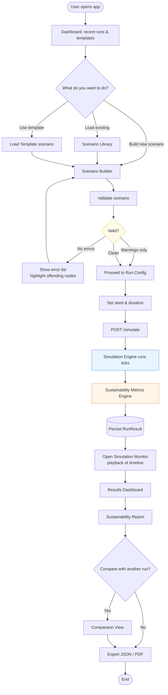
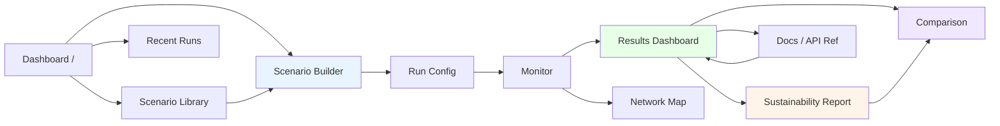

# BUP CSE Fest 2026 — Fuel Supply Simulator
## System Design & Implementation Specification

Companion to `BRIEF.md`. Read the Integration Guide PDF alongside this — this document tells you *what to build and how*, the PDF tells you the *exact contract* the harness expects.

---

# Table of Contents

1. [System Overview](#1-system-overview)
2. [Actors & Users](#2-actors--users)
3. [Feature Inventory](#3-feature-inventory)
4. [Frontend Pages](#4-frontend-pages)
5. [Core Logic & Algorithms](#5-core-logic--algorithms)
6. [Activity Diagrams](#6-activity-diagrams)
7. [Data Model](#7-data-model)
8. [API / Integration Contract](#8-api--integration-contract)
9. [Implementation Roadmap](#9-implementation-roadmap)
10. [Complete Action Checklist](#10-complete-action-checklist)

---

# 1. System Overview

## 1.1 What the system is

A **discrete-event / fixed-timestep simulation engine** for fuel logistics, wrapped in a web UI and an API that an external judging harness can call.

Three layers, strictly separated:

```
┌─────────────────────────────────────────────────────────────┐
│  PRESENTATION LAYER (React)                                 │
│  Scenario Builder · Run Monitor · Results Dashboard · Report │
└───────────────────────────┬─────────────────────────────────┘
                            │ HTTP / JSON
┌───────────────────────────▼─────────────────────────────────┐
│  APPLICATION LAYER (FastAPI)                                │
│  Scenario API · Run API · Report API · Static results       │
└───────────────────────────┬─────────────────────────────────┘
                            │ pure function calls
┌───────────────────────────▼─────────────────────────────────┐
│  DOMAIN LAYER (pure Python, zero I/O, 100% unit-testable)   │
│  Model · Engine · Dispatcher · Metrics · Sustainability      │
└─────────────────────────────────────────────────────────────┘
```

**The single most important architectural rule:** the domain layer must be a pure function of `(scenario, seed)`. Same inputs → byte-identical outputs, forever. The harness runs your code; if results are non-deterministic, you cannot be scored reliably.

## 1.2 Core simulation concept

Fuel moves through a **directed acyclic graph** of nodes:

```
[Refinery] ──route──▶ [Depot] ──route──▶ [Station] ──▶ [Consumer]
   supply              buffer            point of sale
```

- **Tick** = one unit of simulated time (default: 1 hour)
- Each tick: supply replenishes → vehicles dispatch → fuel arrives → consumers buy → metrics recorded
- Run = `duration_ticks` iterations of that loop
- Total simulated time = `ticks × tick_minutes`

## 1.3 The output contract (what judges see)

Every run produces one **Run Result** object:

```
{
  "run_id": "...",
  "seed": 42,
  "scenario": { ...normalized input... },
  "timeline": [ { tick, nodes: {...}, flows: {...} }, ... ],
  "final_state": { ...inventory at every node... },
  "sustainability": { emissions, waste, utilization, ... },
  "summary": { total_supplied, total_delivered, total_shortfall, ... }
}
```

---

# 2. Actors & Users

## 2.1 Primary user (the actual customer of this UI)

**Name:** Tanmim / logistics analyst / sustainability auditor — a **non-technical domain expert** who wants to answer: *"If we run this network, where does fuel go missing, and what does it cost the planet?"*

**Technical skill:** moderate. Comfortable with forms and charts. Will **not** read your source code.

**What they need:**
- Build a scenario without writing code
- See the simulation animate/step
- Understand *why* a shortage happened
- Export a defensible sustainability number for a report

## 2.2 Secondary user

**Name:** The **judging harness** (automated). Runs your simulator on its own scenarios and parses the output. Has no UI. Needs a stable, documented interface.

## 2.3 Tertiary users

| User | Need |
|---|---|
| **Team developer** | Fast iteration, unit tests, reproducible runs, easy scenario debugging |
| **Team presenter** | A polished demo path that tells a story in 3 minutes |
| **Mentor / reviewer** | Readable code, architecture diagram, test coverage, honest README |
| **Event admin** | Ability to run standard demo scenarios reliably during a live demo |

## 2.4 Persona summary

```
                    ┌──────────────────────┐
                    │   Domain Analyst     │  ← PRIMARY: wants answers, not code
                    │  (business user)     │
                    └──────────┬───────────┘
                               │ builds scenario, runs sim, reads report
                               ▼
                    ┌──────────────────────┐
                    │   Web Frontend       │
                    │  (React SPA)         │
                    └──────────┬───────────┘
                               │ JSON over HTTP
                    ┌──────────▼───────────┐
                    │   API / FastAPI      │
                    └──────────┬───────────┘
                               │ pure calls
                    ┌──────────▼───────────┐
                    │  Simulation Engine   │  ← domain logic, pure, tested
                    └──────────────────────┘
                               ▲
                               │ scenario + seed
                    ┌──────────┴───────────┐
                    │   Judging Harness    │  ← SECONDARY: automated caller
                    └──────────────────────┘
```

---

# 3. Feature Inventory

Organized in tiers. **Tier 1 is the judged core** — if any Tier 1 item is missing or broken, the submission fails. Tier 2 differentiates. Tier 3 is polish.

---

## TIER 1 — Core (must build, judged directly)

### F1.1 Scenario Configuration
| Sub-feature | Detail |
|---|---|
| F1.1.1 | Define fuel types with properties: name, density (kg/L), carbon intensity (kg CO₂/L), calorific value, unit cost |
| F1.1.2 | Define **sources**: refilleries/depots with production capacity per tick, initial stock, availability window |
| F1.1.3 | Define **distributors**: storage capacity (max stock), initial stock, loading/unloading rates |
| F1.1.4 | Define **consumers**: stations/regions with demand profile (fixed per tick, or a curve), max intake |
| F1.1.5 | Define **routes**: origin → destination, transit time (ticks), vehicle capacity, number of vehicles, transport emission factor (kg CO₂ per litre-km or per trip) |
| F1.1.6 | Define **simulation window**: duration (ticks), tick length (minutes), seed |
| F1.1.7 | Validate all of the above (see §5.6) |

### F1.2 Simulation Engine
| Sub-feature | Detail |
|---|---|
| F1.2.1 | Fixed-timestep tick loop, `for tick in range(0, duration)` |
| F1.2.2 | Per-tick order of operations (supply → dispatch → transit → delivery → consumption → metrics) |
| F1.2.3 | Deterministic RNG seeded from `seed`; **never** use global `random` |
| F1.2.4 | Track inventory at every node at every tick |
| F1.2.5 | Track in-transit shipments (origin, destination, quantity, arrival tick) |
| F1.2.6 | Detect and handle: depletion, stockout, capacity overflow, unmet demand, stranded inventory |
| F1.2.7 | Emit a **timeline** array — one record per tick |
| F1.2.8 | Produce final aggregate summary |

### F1.3 Sustainability Metrics Engine
This is the **judging differentiator**. Must be first-class, not bolted on.

| Metric | Definition |
|---|---|
| **Total supplied** | Sum of all fuel produced/entered the system (L) |
| **Total delivered** | Sum of all fuel received by consumers (L) |
| **Total shortfall** | Sum of unmet demand (L) — the primary failure signal |
| **Service level** | `delivered / demanded` (%), with per-consumer breakdown |
| **Utilization rate** | `delivered / supplied` (%) — inverse is wasted supply |
| **Dead stock / waste** | Fuel left in nodes at end of run (L), + fuel exceeding shelf life |
| **Transport emissions** | `Σ (litres moved × route distance_km × route emission_factor)` → kg CO₂ |
| **Production emissions** | `Σ (litres produced × fuel_type.carbon_intensity)` → kg CO₂ |
| **Total emissions** | Transport + Production, with per-litre intensity |
| **Waste cost** | Dead stock × fuel unit cost (BDT) |
| **Equity / fairness** | Distribution of service level across consumers (min, max, stddev) — prevents "one happy consumer" gaming |
| **Efficiency score** | Composite normalized score, 0–100, combining service level, utilization, and emissions |
| **Per-litre carbon intensity** | `total_emissions / total_delivered` — the headline sustainability number |

### F1.4 Report Generation
- Summary report: totals, service level, headline sustainability metrics
- Per-node breakdown: final stock, peak stock, throughput, time spent at zero
- Per-consumer breakdown: demand, delivered, unmet, service %
- Route utilization: trips made, load factor (%), idle trips, emissions per route
- Timeline series suitable for charting (stock levels, service level, emissions rate)
- **Export**: download report as JSON and as PDF/printable view
- Comparison mode: run two scenarios side by side (baseline vs optimized) — high impact for "sustainability" story

### F1.5 API / Harness Contract
> ⚠️ **This is the highest-risk area. Implement and verify this FIRST.**

- Single documented entry point to run a scenario (exact path/format per the Integration Guide PDF)
- **JSON in / JSON out**, machine-parseable
- Scenario supplied as structured input (file path or request body) — **never hardcoded**
- Deterministic: same scenario + same seed → identical output bytes
- Clear error responses for invalid input (non-zero exit / structured error, never a stack trace or silent garbage)
- Runs to completion without manual steps
- Response includes `seed` and normalized scenario so results are self-documenting

### F1.6 Frontend (minimum viable)
- Scenario builder form covering all F1.1 fields
- Run trigger
- Results dashboard: KPI cards + at least one time-series chart + per-node/consumer tables
- Sustainability panel with the headline metrics
- JSON result viewer / download

---

## TIER 2 — Differentiators (build after Tier 1 is solid)

| ID | Feature | Value to judges |
|---|---|---|
| F2.1 | **Optimization / auto-scheduling** — find allocation & routing that maximizes service level while minimizing emissions (greedy or heuristic + local search) | Shows engineering depth beyond simulation |
| F2.2 | **Scenario comparison** — baseline vs tuned, diff of all KPIs | Directly demonstrates sustainability improvement |
| F2.3 | **Live animated visualization** — network graph (nodes/edges) with fuel particles flowing, colour-coded by congestion | "Wow factor" for live demo |
| F2.4 | **Interactive charts** — zoom, filter, brush, hover tooltips on time series | UX judging criterion |
| F2.5 | **What-if sandbox** — tweak one parameter, re-run instantly, see delta | Empowers the analyst persona |
| F2.6 | **Disruption modelling** — source failure, road closure, demand surge | Robustness / realism |
| F2.7 | **Scenario library** — load/save/share named scenarios as JSON files | Usability |
| F2.8 | **Time controls** — play/pause/step/speed through the timeline | Makes the sim legible |
| F2.9 | **Alerting / threshold warnings** — flag when a node nears capacity or stockout occurs | Analyst-friendly |
| F2.10 | **Carbon intensity benchmarking** — compare against per-litre benchmark | Makes the sustainability number meaningful |

## TIER 3 — Polish

| ID | Feature |
|---|---|
| F3.1 | Dark/light theme, responsive layout |
| F3.2 | Export PDF report (print stylesheet or client-side lib) |
| F3.3 | Import/export scenario as file |
| F3.4 | Keyboard shortcuts, accessible focus states, ARIA labels |
| F3.5 | Loading states, error boundaries, empty states |
| F3.6 | Animated number counters on KPI cards |
| F3.7 | Dockerfile + one-command local run |
| F3.8 | In-app docs / tooltips explaining each metric |

---

# 4. Frontend Pages

## 4.1 Page inventory

| # | Page | Route | Audience | Priority |
|---|---|---|---|---|
| P1 | **Dashboard / Home** | `/` | All | P2 |
| P2 | **Scenario Builder** | `/scenario` | Analyst | **P1** |
| P3 | **Run Configuration** | `/run` | Analyst | **P1** |
| P4 | **Simulation Monitor** | `/run/:runId` | Analyst, Presenter | **P1** |
| P5 | **Results Dashboard** | `/results/:runId` | Analyst, Judges | **P1** |
| P6 | **Sustainability Report** | `/sustainability/:runId` | Analyst, Judges | **P1** |
| P7 | **Network Map / Graph** | `/network/:runId` | Presenter | P2 |
| P8 | **Comparison** | `/compare` | Analyst, Presenter | P2 |
| P9 | **Scenario Library** | `/scenarios` | Analyst | P2 |
| P10 | **Docs / API Reference** | `/docs` | Harness dev, Mentor | P2 |
| P11 | **404 / Error** | `*` | All | P3 |

## 4.2 Page-by-page detail

### P2 — Scenario Builder `/scenario`  ⭐ CORE

**Purpose:** construct the network without writing code. This is the page that makes the product usable by a non-technical user.

**Layout:** 3-column — palette (node/route types) | canvas/editor | property inspector

**Blocks:**
- **Fuel types panel** — add/edit/remove fuel types with their properties
- **Nodes panel** — add refinery / depot / station / consumer; assign fuel type, capacity, initial stock
- **Routes panel** — link two nodes; set transit time, vehicle count, vehicle capacity, distance, emission factor
- **Demand panel** — per consumer: fixed demand/tick or curve (peak-hour multiplier array)
- **Global settings** — duration (ticks), tick length (minutes), seed
- **Property inspector** — edit the selected node/route in detail
- **Validation panel** — live error/warning list (unreachable nodes, demand with no route, capacity = 0, cycle detection)
- **Actions** — Load sample · Save · Export JSON · Import JSON · Reset

**Key UX:** live mini-preview of the network graph; validation runs on every change; "Generate a valid random scenario" button for quick testing.

---

### P3 — Run Configuration `/run`  ⭐ CORE

**Purpose:** choose how to execute the scenario.

**Sections:**
- **Scenario summary** — node count, route count, total demand, total supply
- **Run options** — seed (with "randomize" and lock toggle), duration override, tick length override, compare-with-baseline toggle
- **Environment note** — which engine version/commit produced this run
- **Big Run button** — with progress indicator for long runs
- **Harness hint** — shows the exact CLI/API call to reproduce this run (very useful for judges)

---

### P4 — Simulation Monitor `/run/:runId`  ⭐ CORE

**Purpose:** watch the simulation happen. This is the live-demo centrepiece.

**Elements:**
- **Time scrubber** — drag through ticks; the whole UI follows the scrubber
- **Transport controls** — ⏮ reset · ⏪ step back · ⏯ play/pause · ⏩ step forward · ⏭ end; speed multiplier (0.5×/1×/2×/8×)
- **Live network canvas** — nodes sized by throughput, coloured by health (green = healthy, amber = low stock, red = stockout); edges animated with flow particles; in-transit shipments shown as moving markers
- **Live tick stats** — current tick, fuel in system, in transit, delivered so far, unmet so far
- **Event ticker** — timestamped log: `t=14 | Depot A stockout | 3 orders unfilled | 250 L`

**Why it matters:** judges need to *see* the difference between "a number went down" and "the network visibly starved."

---

### P5 — Results Dashboard `/results/:runId`  ⭐ CORE

**Purpose:** the analytical payoff.

**Sections:**
- **KPI card row** — Total Delivered · Total Shortfall · Service Level % · Utilization % · Dead Stock · Emissions (kg CO₂) · Carbon Intensity (kg/L) · Efficiency Score
- **Time-series charts** — inventory per node over time; service level over time; delivered vs demand per tick; emissions accumulation; stockout events as markers
- **Per-node table** — node, type, initial stock, final stock, peak stock, throughput in/out, ticks at zero, utilization %
- **Per-consumer table** — consumer, total demand, delivered, unmet, service %, first unmet tick
- **Route table** — trips, load factor %, empty trips, emissions, cost
- **Actions** — Download JSON · Print/PDF · Open Sustainability Report · Open Network Map · Compare with another run

---

### P6 — Sustainability Report `/sustainability/:runId`  ⭐ CORE

**Purpose:** the sustainability story, isolated and quotable.

**Sections:**
- **Headline** — carbon intensity (kg CO₂/L) + efficiency score + total emissions, large typography
- **Emissions breakdown** — stacked bar (production vs transport) + per-route contribution
- **Waste analysis** — dead stock by node, value in BDT, waste %
- **Resource efficiency** — utilization gauge, delivered vs supplied vs wasted
- **Fairness** — service level distribution across consumers (min/median/max, box-style viz)
- **Benchmark comparison** — vs industry baseline per-litre intensity; vs a reference scenario
- **Improvement suggestions** — plain-language recommendations (e.g. "Route 2 load factor only 38%; consolidate trips → est. −120 kg CO₂")
- **Verdict block** — copy-ready summary paragraph for a report
- **Export** — PDF/print

---

### P7 — Network Map `/network/:runId` (P2)

Full-screen network visualization. Node size ∝ total throughput, edge thickness ∝ volume moved, colour ∝ health/stress. Hover → tooltip with details. Scrubbable timeline. "Best route path" highlight toggle.

### P8 — Comparison `/compare` (P2)

Select run A and run B. Side-by-side KPI diff with deltas and % change, overlaid charts, "what changed in my scenario" diff view.

### P9 — Scenario Library `/scenarios` (P2)

Grid of saved scenarios: name, description, tags, node/route counts, last run date. Load / duplicate / delete / export. Built-in samples: Balanced, Shortage, Over-supply, Disruption, Bottleneck.

### P10 — Docs `/docs` (P2)

In-app documentation: how to run, config schema reference, output schema reference, metric definitions, API examples with copy-paste curl. Renders from the same source as the README.

### P1 — Dashboard `/` (P2)

Landing: recent runs (with mini KPI sparklines), quick-start scenario templates, "run the demo" one-click button, headline sustainability summary of the latest run.

---

## 4.3 Page → feature mapping

| Feature | P2 | P3 | P4 | P5 | P6 | P7 | P8 |
|---|---|---|---|---|---|---|---|
| Scenario editing | ● | | | | | | |
| Run control | | ● | ● | | | | |
| Live animation | | | ● | | | ● | |
| Time-series charts | | | | ● | ● | | ● |
| KPI cards | | | | ● | ● | | ● |
| Sustainability metrics | | | | ○ | ● | | ● |
| Node/consumer tables | | | | ● | | | |
| Export JSON/PDF | | | | ● | ● | | |
| Comparison | | | | | | | ● |
| Network graph | ○ | | ● | | | ● | |

● = primary  ○ = secondary

---

# 5. Core Logic & Algorithms

## 5.1 The tick loop (heart of the system)

```
for tick in 0 .. duration-1:

  # PHASE 1 — SUPPLY
  for each source:
      produced = min(capacity_per_tick, demand_signal)   # seeded noise
      stock[source] += produced
      record production

  # PHASE 2 — DISPATCH (decide what moves where)
  for each route (ordered by priority):
      determine shipments based on:
        - downstream need (stockout pressure)      [primary driver]
        - available stock at origin
        - route capacity (vehicles × vehicle capacity)
        - cost/emissions objective
      for each shipment:
          decrement stock[origin]
          add to in_transit {dest, qty, arrival_tick = tick + transit_ticks}

  # PHASE 3 — ARRIVAL
  for each shipment arriving this tick:
      received = min(qty, remaining_capacity_at_dest)
      stock[dest] += received
      overflow = qty - received      # → rejected/spilled → waste metric
      record delivery, route emissions

  # PHASE 4 — CONSUMPTION
  for each consumer:
      wanted = demand_profile[tick]        # base × time-of-day multiplier × noise
      served  = min(wanted, stock[consumer], max_intake)
      unmet   = wanted - served
      stock[consumer] -= served
      record served, unmet

  # PHASE 5 — EVENTS & METRICS
  detect stockouts, capacity violations, stranded inventory
  update timeline[tick]: stock snapshot, flows, metrics
```

**Ordering rationale:** supply → dispatch → arrival → consumption. Dispatch must see post-supply stock; arrival must land before the consumer buys in the same tick (minimizes apparent latency).

## 5.2 Dispatch policy — the core algorithm

The single most consequential decision in the system. Recommended priority-based heuristic:

```
For each route r (ordered by strategy):
    need[dest]   = max(0, forecast_demand_over_transit_time(dest) - stock[dest])
    spare[origin]= max(0, stock[origin] - safety_stock[origin])
    moveable     = min(need[dest], spare[origin])
    capacity     = r.vehicles × r.vehicle_capacity
    shipment     = min(moveable, capacity)
    if shipment > 0: create shipment
```

**Tie-break / objective (sustainability-aware).** Rather than pure "move as much as possible," rank routes by a cost-adjusted score:

```
score(route) = (urgency_weight × unmet_forecast)
             - (emission_factor × distance × cost_weight)
             - (idleness_penalty × (capacity - shipment))
```

This is a **greedy heuristic** — deliberately not an LP/ILP solver. Reasons:
- Deterministic and fast (runs in milliseconds for realistic networks)
- No solver dependency, no fragile install
- Explainable to judges ("we prioritise urgency, then minimise emissions per litre delivered")
- You can add an optional exact solver later as a stretch goal

**Stretch:** add a local-search pass (try moving one route's allocation to another, keep if total objective improves) to demonstrate optimization depth.

## 5.3 Sustainability computation

```
production_emissions = Σ_ticks Σ_sources ( produced_L × fuel.carbon_intensity )
transport_emissions  = Σ_routes ( litres_moved × route.distance_km × route.emission_factor )
total_emissions      = production_emissions + transport_emissions
carbon_intensity     = total_emissions / max(total_delivered, 1)          # kg CO₂ per litre
utilization          = total_delivered / max(total_supplied, 1)
dead_stock           = Σ_nodes final_stock (excluding stranded-at-source counted once)
service_level        = total_delivered / max(total_demanded, 1)
efficiency_score     = 100 × w1·service_level + w2·utilization + w3·(1 - normalized_emissions)
                      with w1=0.5, w2=0.3, w3=0.2   (weights documented & configurable)
```

**Important:** `normalized_emissions` needs a documented reference (e.g. against a benchmark per-litre intensity) so the score is meaningful, not arbitrary. Document the normalization formula in the README.

**Waste (dead stock) — subtle:** fuel sitting at a source that was never dispatched is *not* the same as fuel a consumer couldn't buy. Count both, but report separately:
- `unused_supply` — produced but never left a source
- `unserved_demand` — wanted but never delivered
- `overflow_spill` — arrived but destination had no capacity

## 5.4 Demand modelling

```
demand(tick) = base_demand
             × time_of_day_multiplier[tick % ticks_per_day]
             × weekday_multiplier          (if weekend modelling enabled)
             × (1 + noise(seed, tick, consumer))    # seeded, bounded ±X%
```

Keep the curve generator pluggable: `fixed`, `linear_growth`, `daily_cycle`, `spike`. A `daily_cycle` with a morning/evening peak makes demos look realistic immediately.

## 5.5 Determinism rules (critical for the harness)

| Rule | Detail |
|---|---|
| No global RNG | Always `rng = random.Random(seed + derived_index)`; derive a stable per-entity seed from (seed, entity_id, tick) |
| No wall-clock in results | Timestamps only in metadata, never in the scored payload; keep `run_id` random but keep `seed` deterministic |
| No dict ordering dependence | Sort all iterations by stable entity id |
| No float accumulation drift | Round to fixed decimals (e.g. 3) when serializing; use integers (millilitres) internally to avoid float drift |
| Version the output | Include `engine_version` in every result so a harness can reason about format changes |
| Golden tests | Store expected outputs for 3–4 fixed scenarios; assert equality in CI — this is your guarantee |

**Use integer millilitres internally** (store 1500 for 1.5 L). Eliminates a whole class of float drift bugs and makes assertions exact.

## 5.6 Validation rules (fail loudly)

| Rule | Message shape |
|---|---|
| Demand exists but no route reaches it | `"Consumer 'C1' has demand but no inbound route"` |
| Route endpoints missing | `"Route 'R2' references unknown node 'X'"` |
| Negative / zero capacity | `"Node 'D1' storage_capacity must be > 0"` |
| Negative quantity | `"Consumer 'C2' base_demand cannot be negative"` |
| Vehicle capacity < route need | warning: `"Route 'R1' capacity may bottleneck node 'S1'"` |
| Cycle in graph | warning: `"Cycle detected S1→D1→S1 — infinite loop risk"` |
| Duration ≤ 0 | `"duration must be >= 1 tick"` |
| No sources at all | `"Scenario defines no fuel sources"` |

**Two-tier policy:**
- **Errors** (impossible scenario) → abort the run, return a structured error with the list of problems
- **Warnings** (legal but suspicious) → proceed, surface them in the UI and in `result.warnings`

## 5.7 Error handling matrix

| Failure | Behaviour |
|---|---|
| Invalid scenario JSON | 400 + `{ "error": "invalid_scenario", "issues": [...] }` |
| Unknown node in route | 400 + issue list |
| Simulation internal invariant broken | 500 + `{"error": "internal_error", "engine_version": ...}` — never a raw stack trace to the harness |
| Run too large (e.g. > 1M ticks) | 400 + `"scenario_too_large"` |
| Frontend fetch fails | Error boundary + retry button, show the request that failed |
| Missing run ID in URL | Redirect to dashboard with a toast |

## 5.8 Data structures (at a glance)

```python
FuelType(id, name, density_kg_per_l, carbon_intensity_kg_per_l, unit_cost_bdt, shelf_life_ticks)

Node(id, name, type[refinery|depot|station|consumer],
     fuel_type_id, storage_capacity, initial_stock,
     production_capacity_per_tick,  # refineries only
     base_demand, demand_pattern,   # consumers only
     max_intake, safety_stock)

Route(id, name, origin_id, destination_id,
      transit_ticks, vehicle_count, vehicle_capacity,
      distance_km, emission_factor, cost_per_trip)

Scenario(id, name, description, duration_ticks, tick_minutes,
         fuel_types[], nodes[], routes[], seed)

TimelineEntry(tick, stock: {node_id: int_ml}, in_transit: {route_id: int_ml},
              delivered: int_ml, demanded: int_ml, unmet: int_ml,
              emissions_kg: float, events: [])

RunResult(run_id, seed, engine_version, scenario, timeline,
           final_state, sustainability, summary, warnings)
```

---

# 6. Activity Diagrams

## 6.1 Master flow — from user intent to report



## 6.2 Scenario Builder — edit & validate

```mermaid
flowchart TD
    Start([Open Scenario Builder]) --> Load[Load existing / blank scenario]
    Load --> Canvas[Render network canvas]

    Canvas --> Action{User action}

    Action -->|Add fuel type| FT[Form: name, density,<br/>carbon intensity, cost, shelf life]
    Action -->|Add node| AN[Pick type: refinery / depot /<br/>station / consumer]
    Action -->|Add route| AR[Pick origin & destination,<br/>transit time, vehicles,<br/>capacity, distance, emission factor]
    Action -->|Edit selection| IN[Inspector panel:<br/>edit all properties]
    Action -->|Delete selection| DL[Remove + cascade warn]
    Action -->|Set global settings| GS[duration, tick length, seed]

    FT --> Canvas
    AN --> Canvas
    AR --> Canvas
    IN --> Canvas
    DL --> Canvas
    GS --> Canvas

    Canvas --> Trigger{Trigger}
    Trigger -->|On any change| ReValidate[Run validation]
    Trigger -->|On blur| ReValidate
    Trigger -->|On save| ReValidate

    ReValidate --> Errors{Errors found?}
    Errors -->|Yes| ShowErr[Show error list<br/>block "Run Simulation"]
    ShowErr --> Canvas
    Errors -->|No| Warn{Warnings?}
    Warn -->|Yes| ShowWarn[Show warnings<br/>allow run]
    Warn -->|No| Enable[Enable "Run Simulation"]

    ShowWarn --> Canvas
    Enable --> Save[Save to library / Export JSON]

    style Errors fill:#ffe8e8,stroke:#d95c5c
    style Enable fill:#e8ffe8,stroke:#4ad95c
    style ReValidate fill:#f0e8ff,stroke:#9b6bd9
```

## 6.3 Simulation Engine — one tick (core loop)

```mermaid
flowchart TD
    T0([Begin tick t]) --> P1[PHASE 1: SUPPLY<br/>add production to each source<br/>apply seeded noise]
    P1 --> P2[PHASE 2: DISPATCH<br/>compute need & spare per node<br/>rank routes by urgency−emissions score<br/>create shipments, decrement origin stock]

    P2 --> P3[PHASE 3: ARRIVAL<br/>deliver shipments arriving at t<br/>handle capacity overflow → spill]
    P3 --> P4[PHASE 4: CONSUMPTION<br/>each consumer: wanted = profile×noise<br/>served = min(wanted, stock, max_intake)<br/>unmet = wanted − served<br/>decrement stock]

    P4 --> P5[PHASE 5: EVENTS & METRICS<br/>detect stockout / overflow / stranded<br/>accumulate emissions, waste, service level]
    P5 --> Snap[Append snapshot to timeline]

    Snap --> More{More ticks?}
    More -->|Yes| T0
    More -->|No| Agg[AGGREGATE<br/>final state, totals,<br/>sustainability metrics, summary]

    Agg --> End([Return RunResult])

    style P1 fill:#e8f4ff,stroke:#4a90d9
    style P2 fill:#fff4e8,stroke:#e8964a
    style P3 fill:#f0e8ff,stroke:#9b6bd9
    style P4 fill:#fffbe8,stroke:#d9c44a
    style P5 fill:#ffe8f0,stroke:#d95c8c
    style Agg fill:#e8ffe8,stroke:#4ad95c
```

## 6.4 Dispatch decision — per route, per tick

```mermaid
flowchart TD
    R0([Evaluate route R]) --> Origin{Ok to draw from origin?<br/>stock > safety_stock?}
    Origin -->|No| Skip[No shipment]

    Origin -->|Yes| Need[need = forecast demand over transit time<br/>− current dest stock<br/>clamp to ≥ 0]
    Need --> Spare[spare = origin stock − safety stock]
    Spare --> Cap[capacity = vehicles × vehicle_capacity<br/>available vehicles this tick]
    Need --> Move[moveable = min(need, spare)]
    Cap --> Move

    Move --> Zero{moveable > 0?}
    Zero -->|No| Skip
    Zero -->|Yes| Score[score = urgency × need<br/>− emission_cost(route)<br/>− idleness_penalty × unused capacity]

    Score --> Rank[Insert into ranked shipment list]
    Rank --> Create[Create shipment:<br/>qty, destination,<br/>arrival_tick = t + transit_ticks]
    Create --> Emit[Decrement origin stock]

    Skip --> Next([Next route])
    Emit --> Next

    style Zero fill:#fffbe8,stroke:#d9c44a
    style Score fill:#ffe8f0,stroke:#d95c8c
    style Create fill:#e8ffe8,stroke:#4ad95c
```

## 6.5 Sustainability metrics computation

```mermaid
flowchart TD
    S0([End of run]) --> Collect[Collect per-tick records]

    Collect --> T1[Total supplied = Σ production]
    Collect --> T2[Total delivered = Σ served]
    Collect --> T3[Total demanded = Σ wanted]
    Collect --> T4[Total unmet = Σ (wanted − served)]
    Collect --> T5[Dead stock = Σ final node stock]
    Collect --> T6[Unused supply = supplied − dispatched]
    Collect --> T7[Overflow spill = Σ rejected arrivals]
    Collect --> T8[Transport emissions = Σ litres × km × factor]
    Collect --> T9[Production emissions = Σ litres × carbon intensity]

    T1 --> Calc
    T2 --> Calc
    T3 --> Calc
    T4 --> Calc
    T5 --> Calc
    T6 --> Calc
    T7 --> Calc
    T8 --> Calc
    T9 --> Calc

    Calc[Compute derived ratios] --> C1[Service level = delivered / demanded]
    Calc --> C2[Utilization = delivered / supplied]
    Calc --> C3[Carbon intensity = total emissions / delivered]
    Calc --> C4[Waste % = (dead stock + spill) / supplied]
    Calc --> C5[Fairness = min / max / stddev of per-consumer service]

    C1 --> Score
    C2 --> Score
    C4 --> Score
    C3 --> Norm[Normalize emissions<br/>vs documented benchmark]
    Norm --> Score

    Score[Assemble SustainabilityReport] --> Verdict[Generate plain-language verdict<br/>+ improvement suggestions]
    Verdict --> Done([Report ready])

    style Calc fill:#fff4e8,stroke:#e8964a
    style Score fill:#e8ffe8,stroke:#4ad95c
    style Norm fill:#f0e8ff,stroke:#9b6bd9
```

## 6.6 API request → response (harness path)

```mermaid
flowchart TD
    H([Harness sends request]) --> Parse[Parse scenario JSON + seed]
    Parse --> Schema{Schema valid?}
    Schema -->|No| E1[400 invalid_scenario<br/>+ issues list]
    Schema -->|Yes| Bounds{Within size limits?}
    Bounds -->|No| E2[400 scenario_too_large]
    Bounds -->|Yes| Validate[Semantic validation<br/>reachability, capacities, cycles]

    Validate --> Ok{Valid?}
    Ok -->|No| E1
    Ok -->|Yes| Seed[Derive per-entity seeded RNG]

    Seed --> Run[Execute tick loop]
    Run --> Invariant{Invariants hold?<br/>no negative stock,<br/>no mass non-conservation]
    Invariant -->|No| E3[500 internal_error<br/>+ engine_version]
    Invariant -->|Yes| Metrics[Compute sustainability metrics]

    Metrics --> Shape[Serialize to fixed schema<br/>round to fixed decimals<br/>sort arrays deterministically]
    Shape --> Check{Diff against golden file?}
    Check -->|Mismatch| E4[500 nondeterminism_detected<br/>(dev signal — must never ship)]
    Check -->|Match| Ok2([200 OK<br/>RunResult JSON])

    E1 --> End([Response])
    E2 --> End
    E3 --> End
    E4 --> End
    Ok2 --> End

    style Schema fill:#fffbe8,stroke:#d9c44a
    style Invariant fill:#ffe8e8,stroke:#d95c5c
    style Check fill:#f0e8ff,stroke:#9b6bd9
    style Ok2 fill:#e8ffe8,stroke:#4ad95c
```

## 6.7 Frontend navigation



---

# 7. Data Model

## 7.1 Entity relationships

```
Scenario ─┬─< FuelType
          ├─< Node (refinery | depot | station | consumer)
          └─< Route (origin → destination)

RunResult ─┬─ references Scenario (normalized copy)
           ├─< TimelineEntry (one per tick)
           ├─ SustainabilityReport
           └─ Summary + FinalState

Route: origin_id ──> Node.id
       destination_id ──> Node.id
```

## 7.2 Storage decision

| Data | Store in | Why |
|---|---|---|
| Scenario definitions | SQLite (or JSON files on disk) | Small, needs query/listing; JSON files are simplest and version-controllable |
| Run results | SQLite, or in-memory + file cache | Runs can be large (timeline per tick). Cap retention (e.g. last 50 runs) |
| Seeded RNG state | Not persisted | Derived deterministically from seed + entity id |

**Keep it simple:** JSON files for scenarios (easy for judges to inspect and diff) + SQLite for runs (queryable for the dashboard's "recent runs" list). If time is short, an in-memory store with a JSON-file fallback is acceptable.

---

# 8. API / Integration Contract

> ⚠️ **Verify every field name, path, and format against the Integration Guide PDF.** The below is a template — the PDF is authoritative.

## 8.1 Endpoints

| Method | Path | Purpose |
|---|---|---|
| `POST` | `/api/simulate` | **Primary entry point.** Body = `{ scenario, seed? }` → returns `RunResult` |
| `GET` | `/api/simulate/{run_id}` | Fetch a previously computed run |
| `POST` | `/api/scenarios` | Save a scenario definition |
| `GET` | `/api/scenarios` | List saved scenarios |
| `GET` | `/api/scenarios/{id}` | Fetch one scenario |
| `POST` | `/api/validate` | Validate a scenario, return issues without running |
| `GET` | `/api/health` | Liveness check |
| `GET` | `/api/schema` | JSON Schema for scenario input **and** run output |
| `GET` | `/api/samples/{name}` | Bundled sample scenarios |
| `GET` | `/docs` | Auto-generated OpenAPI (FastAPI) |

## 8.2 Request

```json
{
  "seed": 42,
  "scenario": {
    "id": "demo-1",
    "name": "Balanced Network",
    "duration_ticks": 24,
    "tick_minutes": 60,
    "fuel_types": [
      {
        "id": "ft_diesel",
        "name": "Diesel",
        "density_kg_per_l": 0.84,
        "carbon_intensity_kg_per_l": 2.68,
        "unit_cost_bdt": 95,
        "shelf_life_ticks": 720
      }
    ],
    "nodes": [
      {
        "id": "ref_01", "name": "Chattogram Refinery", "type": "refinery",
        "fuel_type_id": "ft_diesel", "storage_capacity": 500000,
        "initial_stock": 200000, "production_capacity_per_tick": 40000
      },
      {
        "id": "dep_01", "name": "North Depot", "type": "depot",
        "fuel_type_id": "ft_diesel", "storage_capacity": 300000,
        "initial_stock": 100000
      },
      {
        "id": "stn_01", "name": "Mirpur Station", "type": "station",
        "fuel_type_id": "ft_diesel", "storage_capacity": 20000,
        "initial_stock": 5000
      },
      {
        "id": "con_01", "name": "Uttara Consumers", "type": "consumer",
        "fuel_type_id": "ft_diesel", "base_demand": 12000,
        "demand_pattern": "daily_cycle", "max_intake": 15000
      }
    ],
    "routes": [
      {
        "id": "rt_01", "name": "Refinery → Depot",
        "origin_id": "ref_01", "destination_id": "dep_01",
        "transit_ticks": 2, "vehicle_count": 4, "vehicle_capacity": 30000,
        "distance_km": 65, "emission_factor": 0.00021, "cost_per_trip": 4500
      }
    ]
  }
}
```

## 8.3 Response

```json
{
  "run_id": "r_8f3a1c",
  "engine_version": "1.0.0",
  "seed": 42,
  "scenario": { "...": "normalized copy of input" },
  "summary": {
    "total_supplied_ml": 960000,
    "total_demanded_ml": 288000,
    "total_delivered_ml": 276000,
    "total_unmet_ml": 12000,
    "service_level": 0.9583,
    "utilization": 0.8906,
    "dead_stock_ml": 84000
  },
  "sustainability": {
    "production_emissions_kg": 2572.8,
    "transport_emissions_kg": 37.6,
    "total_emissions_kg": 2610.4,
    "carbon_intensity_kg_per_l": 0.00946,
    "unused_supply_ml": 96000,
    "overflow_spill_ml": 0,
    "waste_value_bdt": 900000,
    "service_level_min": 0.8833,
    "service_level_max": 1.0,
    "service_level_stddev": 0.0491,
    "efficiency_score": 78.4,
    "benchmark": { "reference_intensity_kg_per_l": 0.0115, "delta_pct": -17.7 }
  },
  "timeline": [
    {
      "tick": 0,
      "stock_ml": { "ref_01": 200000, "dep_01": 100000, "stn_01": 5000, "con_01": 0 },
      "in_transit_ml": { "rt_01": 0 },
      "delivered_ml": 0,
      "demanded_ml": 12000,
      "unmet_ml": 0,
      "emissions_kg": 0.0,
      "events": []
    }
  ],
  "final_state": { "...": "final inventory per node" },
  "warnings": ["Route 'rt_01' load factor 38% — consider consolidating trips"],
  "errors": []
}
```

## 8.4 Contract guarantees to state explicitly in your README

1. **Determinism** — same `(scenario, seed)` → identical output, always
2. **Purity** — the simulation does not read wall-clock time, environment variables, or filesystem
3. **Versioning** — `engine_version` in every result; output schema versioned
4. **Error shape** — every failure returns `{"error": "<code>", "issues": [...]}` — never a raw exception
5. **Units are explicit** — all volumes in **millilitres** (int), emissions in **kg CO₂**, distances in **km**, time in **ticks**
6. **No side effects** — running a scenario never mutates it; a `POST /simulate` does not write to the scenario store

## 8.5 Also ship a CLI

```
python -m app.cli simulate --scenario scenarios/balanced.json --seed 42 --out result.json
```

The harness may prefer a CLI over HTTP. Provide both. The CLI must exit non-zero on error and print the structured error to **stderr** (leaving stdout clean for the result JSON).

---

# 9. Implementation Roadmap

## 9.1 Phased build order (each phase ends runnable)

| Phase | Focus | Exit criteria |
|---|---|---|
| **Phase 0** | Read Integration Guide PDF; write down the exact entry point & output schema | Schema pinned in `docs/CONTRACT.md` |
| **Phase 1** | Domain layer: models + engine + metrics, **no UI, no API** | Unit tests pass; CLI can simulate a hand-written JSON scenario |
| **Phase 2** | CLI + golden-file determinism tests | Same input → byte-identical output, verified in CI |
| **Phase 3** | FastAPI: `/simulate`, `/validate`, `/schema`, `/health` | Harness can run a scenario end-to-end |
| **Phase 4** | Frontend: Scenario Builder → Run → Results (minimal but functional) | Full loop works in the browser |
| **Phase 5** | Sustainability Report page + polish charts | Judging criterion "sustainability" demonstrably met |
| **Phase 6** | Simulation Monitor (animated playback + network canvas) | Live demo ready |
| **Phase 7** | Tier 2 features (comparison, optimization, disruption) | Differentiation |
| **Phase 8** | README, sample scenarios, demo script, Docker | Submission-ready |

**Phase 1 and 2 are where the real value is.** A fully working CLI simulator with deterministic output and a great README beats a beautiful UI over a broken engine.

## 9.2 Team split (2–4 people)

| Role | Owns |
|---|---|
| **Engineer A — Core** | Domain model, tick loop, dispatch heuristic, metrics, unit tests |
| **Engineer B — Integration** | FastAPI, contract compliance, CLI, determinism/golden tests, Docker, schema docs |
| **Engineer C — Frontend** | Scenario builder, results dashboard, charts, network canvas |
| **Engineer D — Product** (optional) | Sustainability report, comparison, demo script, README, slides |

**Overlap rules:** A owns the engine — nobody else edits domain files without A's review. B owns the contract — the JSON schema is frozen after Phase 3 and changes require B's sign-off. This prevents the classic "frontend changed the payload" bug.

## 9.3 Risk register

| Risk | Impact | Mitigation | Owner |
|---|---|---|---|
| Harness can't run our sim | **Fatal** | Freeze the contract in Phase 0; implement CLI *and* HTTP; test with the guide's own examples | B |
| Non-deterministic output | **Fatal** | Seeded RNG everywhere, integer mL, golden tests in CI | A + B |
| Ran out of time before UI exists | High | Phases 1–2 are backend-only and independently valuable; CLI demo is a valid fallback | All |
| Simulation logic embedded in UI code | High | Enforce domain/API split from day one; domain layer has zero HTTP imports | A |
| Over-engineered, nothing demoable | High | Hard scope gate: no Tier 2 work until Phase 6 exit criteria met | PM |
| Sustainability metrics feel bolted on | Medium | Metrics module designed in Phase 1, not Phase 5 | A |
| Float drift breaks determinism | Medium | Integer millilitres internally; round on serialize | A |
| Backend/frontend payload mismatch | Medium | Generate TS types from the JSON Schema; contract test in CI | B + C |
| Live demo crashes | Medium | Bundled sample scenarios; one-click demo; run the demo 10× beforehand | C |
| Cycle in the network graph hangs the sim | Medium | Cycle detection in validation; route ordering by topological depth | A |

## 9.4 Definition of Done

A submission is done when:

- [ ] `docker compose up` (or `make run`) starts the full stack
- [ ] The Integration Guide's own example scenario runs and returns a valid result
- [ ] Same scenario + seed → identical output, verified twice
- [ ] An invalid scenario returns a structured error, not a crash
- [ ] All four documented pages work: Builder, Monitor, Results, Sustainability
- [ ] Unit tests cover the engine, dispatch heuristic, and metrics; coverage > 80%
- [ ] README documents setup, config schema, output schema, and metric definitions
- [ ] 3+ sample scenarios bundled
- [ ] A 3-minute demo script exists
- [ ] The whole team can explain the dispatch heuristic in one sentence

---

# 10. Complete Action Checklist

## A. Foundation
- [ ] Read the Integration Guide PDF; extract the exact entry point, input format, output format, and error expectations
- [ ] Write `docs/CONTRACT.md` — the frozen interface spec
- [ ] Choose stack; scaffold repo (backend, frontend, `docs/`, `scenarios/`, `tests/`)
- [ ] Set up linting, formatting, type checking, pre-commit hooks
- [ ] Initialize git; agree branch + commit conventions

## B. Domain model
- [ ] Define `FuelType`, `Node`, `Route`, `Scenario` dataclasses (Pydantic models)
- [ ] Define node types & their distinct fields
- [ ] Define `demand_pattern` strategies (fixed / linear / daily_cycle / spike)
- [ ] Define JSON Schema for the scenario input; validate against it
- [ ] Write sample scenarios: balanced, shortage, over-supply, bottleneck, disruption

## C. Simulation engine
- [ ] Implement the tick loop with the 5 phases in §5.1
- [ ] Implement seeded RNG helper: `rng_for(seed, entity_id, tick)`
- [ ] Implement per-entity dispatch decisions
- [ ] Implement route ranking (urgency − emissions − idleness)
- [ ] Implement arrival handling with capacity overflow
- [ ] Implement consumption with demand curves + bounded noise
- [ ] Implement event detection (stockout, overflow, stranded stock, cycle)
- [ ] Record a timeline entry per tick
- [ ] Assert invariants each tick (no negative stock; mass conservation)

## D. Metrics & sustainability
- [ ] Implement totals: supplied, demanded, delivered, unmet
- [ ] Implement service level, utilization, waste %
- [ ] Implement production & transport emissions; carbon intensity
- [ ] Implement dead stock, unused supply, overflow spill, waste value
- [ ] Implement fairness stats across consumers
- [ ] Implement efficiency score + document the normalization + weights
- [ ] Implement plain-language verdict generator + improvement suggestions
- [ ] Implement benchmark comparison

## E. Validation & errors
- [ ] Implement semantic validation (§5.6)
- [ ] Implement two-tier errors/warnings
- [ ] Define the structured error response format
- [ ] Implement size limits and timeouts
- [ ] Implement invariant-violation handling

## F. Integration layer
- [ ] Implement `POST /simulate` exactly per contract
- [ ] Implement `GET /simulate/{run_id}`, `/validate`, `/schema`, `/health`, `/samples`
- [ ] Implement the CLI (`simulate`, `validate`, `list-samples`)
- [ ] CLI: JSON to stdout, errors to stderr, non-zero exit on failure
- [ ] Implement result serialization with fixed rounding & sorted arrays
- [ ] Write golden-file tests (3–4 fixed scenarios)
- [ ] Add a determinism test: run twice, assert byte-identical
- [ ] Freeze the schema; generate TS types for the frontend from it
- [ ] Add Dockerfile + `docker compose up` working locally
- [ ] Write `README.md`: setup, run, config schema, output schema, metric definitions, design rationale

## G. Backend supporting features
- [ ] Scenario store (JSON files or SQLite) with save/list/load/delete
- [ ] Run store with retention cap
- [ ] Seeded "random but valid scenario" generator (useful for demos + testing)
- [ ] Recent-runs list for the dashboard
- [ ] Structured request logging

## H. Frontend — core pages
- [ ] App shell: routing, layout, nav, theme, error boundary
- [ ] API client + generated types
- [ ] **P2 Scenario Builder**: fuel types / nodes / routes / demand / global settings
- [ ] **P2 Scenario Builder**: network canvas with add + select + delete
- [ ] **P2 Scenario Builder**: property inspector, live validation panel, sample loader, import/export
- [ ] **P3 Run Config**: summary, seed control, duration, reproduce-call hint, run button
- [ ] **P4 Simulation Monitor**: timeline scrubber, play/pause/step/speed, live stats, event ticker
- [ ] **P4 Network canvas**: node health colours, flow animation, in-transit markers
- [ ] **P5 Results Dashboard**: KPI cards, time-series charts, per-node table, per-consumer table, route table
- [ ] **P5**: export JSON, print/PDF
- [ ] **P6 Sustainability Report**: headline, emissions breakdown, waste, efficiency, fairness, benchmark, verdict, suggestions

## I. Frontend — supporting
- [ ] P1 Dashboard: recent runs, templates, one-click demo
- [ ] P7 Network Map full screen
- [ ] P8 Comparison view with diffs
- [ ] P9 Scenario Library
- [ ] P10 In-app docs
- [ ] Loading / empty / error states everywhere
- [ ] Responsive layout; accessibility pass

## J. Tier 2 (stretch)
- [ ] Optimization pass (local search on top of greedy)
- [ ] Disruption modelling
- [ ] Threshold alerting
- [ ] Benchmark data table

## K. Testing
- [ ] Unit tests: engine phases, dispatch, metrics, validation
- [ ] Golden-file determinism tests
- [ ] API contract tests (request/response shapes)
- [ ] Frontend: component tests for the builder & charts
- [ ] End-to-end: build scenario → run → see results
- [ ] CI running all of the above on every push

## L. Demo & submission
- [ ] Write the 3-minute demo script (problem → simulate → insight → impact)
- [ ] Record a backup video
- [ ] Prepare slides: architecture diagram, key metrics, sustainability story
- [ ] README polished; demo scenarios bundled
- [ ] Final dry run of the harness contract, end to end, on a clean clone

---

## Appendix A — Glossary

| Term | Meaning |
|---|---|
| **Tick** | One unit of simulated time (default 1 hour) |
| **Node** | A point in the network: refinery, depot, station, or consumer |
| **Route** | A directed link with transit time, vehicle capacity, distance, emission factor |
| **Stock** | Fuel currently held at a node (internally in millilitres) |
| **In transit** | Fuel dispatched but not yet arrived |
| **Service level** | Delivered ÷ demanded (%), overall and per consumer |
| **Utilization** | Delivered ÷ supplied (%) |
| **Dead stock** | Fuel still in the system at end of run |
| **Carbon intensity** | Total kg CO₂ ÷ litres delivered |
| **Stranded supply** | Fuel produced that never left a source |
| **Overflow spill** | Fuel that arrived where there was no capacity to accept it |
| **Golden file** | A stored expected output used to detect unintended changes |
| **Invariant** | A property that must always hold (e.g. no negative stock) |

## Appendix B — Metric formulas (copy-paste for the README)

```
service_level     = total_delivered / total_demanded
utilization       = total_delivered / total_supplied
dead_stock        = Σ final_stock(node)
waste_pct         = (dead_stock + overflow_spill + unused_supply) / total_supplied
production_co2    = Σ_t Σ_s (produced_L(t,s) × carbon_intensity(fuel_type(s)))
transport_co2     = Σ_r (litres_moved(r) × distance_km(r) × emission_factor(r))
total_co2         = production_co2 + transport_co2
carbon_intensity  = total_co2 / total_delivered
waste_value_bdt   = dead_stock / 1000 × unit_cost_bdt
service_level_min = min over consumers of (delivered_c / demanded_c)
service_level_max = max over consumers of (delivered_c / demanded_c)
efficiency_score  = 100 × (0.50 × service_level
                      + 0.30 × utilization
                      + 0.20 × (1 − carbon_intensity / benchmark_intensity))
```
